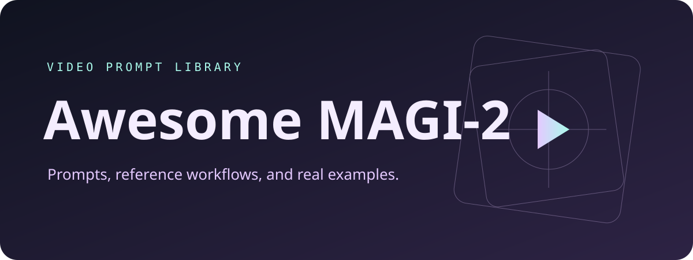

# Awesome MAGI-2

**[English](README.md) · [简体中文](README-zh.md)**

> 从网上收集可追溯的 MAGI-2 视频提示词、输入素材和演示。按用途分类，区分原作者实测、官方示例和未跑过的原创模板。

在 Cyberbara 试用: [文生视频](https://cyberbara.com/ai-video-generator?entry=magi-2&utm_source=awesome-magi-2&utm_medium=github) · [首帧／首尾帧](https://cyberbara.com/ai-video-generator?entry=magi-2-frames&utm_source=awesome-magi-2&utm_medium=github) · [参考生视频](https://cyberbara.com/ai-video-generator?entry=magi-2-reference&utm_source=awesome-magi-2&utm_medium=github)

目录: [精选实测案例](#精选实测案例) · [官方文档与演示](#官方文档与演示) · [MAGI-2 Preview](#magi-2-preview) · [可复制原创模板](#可复制原创模板) · [资源与投稿](#资源与投稿)

## 精选实测案例

以下是发布者标明使用正式版 MAGI-2 运行、并公开了原提示词的案例。点击原文查看提示词和样片；素材仅链接原出处。

每个案例单独成卡。外部作品保留原出处；卡片里的「可复制改写」是另写的模板，不冒充原作者输入。


### 1. 电影感与长镜头

#### 1.1. 30 秒拉面摊一镜到底

- **模式:** Text · 30 s
- **看点:** 用一个长镜头串起对话、上菜和经过的列车。
- **原作者提示词／样片:** [CreateVision](https://createvision.ai/magi-2#:~:text=One%20continuous%2030-second%20take%2C%20no%20cuts.)

<details>
<summary>展开可复制的改写模板（未实测，与原样片不对应）</summary>

```text
One unbroken overhead-to-eye-level move in a quiet station café shortly before closing. Start on coffee dripping into a ceramic mug, then slide along the counter as a passenger sets down a folded train ticket. The attendant says, “You still have time.” Pull back as a departing train passes the window. Sound: coffee machine, one line of dialogue, swish of the train. No music or subtitles.
```

</details>

#### 1.2. 庭院三季延时

- **模式:** First + last frame · 5 s
- **看点:** 固定机位，用两张首尾帧控制季节变化。
- **原作者提示词／样片:** [CreateVision](https://createvision.ai/magi-2#pin-the-first-and-last-frame)

<details>
<summary>展开可复制的改写模板（未实测，与原样片不对应）</summary>

```text
Use the supplied winter and summer images as the exact first and last frames. Lock the camera and preserve the roofline and tree placement. Snow sags off the branches; buds and pale flowers emerge, then give way to green leaves. Keep the seasonal transition smooth with no jump cuts. Sound: wind giving way to birds.
```

</details>

### 2. 对白与短剧

#### 2.1. 巴黎合照开口对话

- **模式:** First frame · 8 s
- **看点:** 从一张照片开始，让两人按顺序对话。
- **原作者提示词／样片:** [CreateVision](https://createvision.ai/magi-2#dialogue-with-lip-sync-in-english-or-mandarin)

<details>
<summary>展开可复制的改写模板（未实测，与原样片不对应）</summary>

```text
Use the uploaded portrait as the first frame. Preserve both faces, coats, and river-view background. The person on the left says, “Is this our stop?” The person on the right smiles and says, “One more bridge.” Only the active speaker’s lips move. Keep the camera nearly still. Sound: close dialogue and river ambience.
```

</details>

#### 2.2. 普通话街头小吃 vlog

- **模式:** Text · 8 s
- **看点:** 摊主用普通话出镜，保留街道环境声。
- **原作者提示词／样片:** [CreateVision](https://createvision.ai/magi-2#:~:text=Vertical%20street-food%20video)

<details>
<summary>展开可复制的改写模板（未实测，与原样片不对应）</summary>

```text
Vertical handheld market profile. A vendor places a fresh pastry in a paper sleeve, looks up, and says in Mandarin, “刚出炉，小心烫。” Hold on the vendor’s expression for the final second. Sound: close voice, light street chatter, and the crinkle of the sleeve. No narration or captions.
```

</details>

#### 2.3. 今晚最后一碗

- **模式:** Text · 5 s
- **看点:** 两段明确的镜头、单句对白，不加音乐。
- **原作者提示词／样片:** [Seadanse](https://seadanse.com/blog/how-to-use-magi-2#:~:text=Last%20bowl%20of%20the%20night)

<details>
<summary>展开可复制的改写模板（未实测，与原样片不对应）</summary>

```text
0–2s: Wide shot of a corner bakery at closing time, water running down the front window. 2–5s: Hard cut to the baker sliding the final loaf across the counter, saying, “This one's for you.” Sound: rain outside, paper on wood, and clear speech. No music.
```

</details>

### 3. 广告与商品演示

#### 3.1. 护肤品口播与标签

- **模式:** Image reference · 10 s
- **看点:** 以商品照约束瓶身，最后用特写展示标签。
- **原作者提示词／样片:** [CreateVision](https://createvision.ai/magi-2#product-shots-that-keep-the-label)

<details>
<summary>展开可复制的改写模板（未实测，与原样片不对应）</summary>

```text
Use the product photo to lock the exact container shape and label. In a vertical frame, a presenter lifts the product beside the face and says, “Here's how I use it.” Cut to the bottle on a pale counter at the end, front label facing the lens. Keep all printed words and colors as in the photo. Sound: voice and a small tap on the counter.
```

</details>

#### 3.2. 把参考运镜转移到商品镜头

- **模式:** Image + video reference · 6 s
- **看点:** 一份参考控制瓶身，另一份参考控制运镜。
- **原作者提示词／样片:** [CreateVision](https://createvision.ai/magi-2#borrow-the-camera-move-from-another-clip)

<details>
<summary>展开可复制的改写模板（未实测，与原样片不对应）</summary>

```text
Use Image 1 for the appearance of the product and Video 1 only for the camera trajectory. Stage the item alone on a slate plinth. Recreate the slow arc followed by a shallow push-in; do not borrow the reference video’s location or soundtrack. End on a steady readable product close-up. Sound: soft room tone.
```

</details>

#### 3.3. 耳机盒开盖特写

- **模式:** Text · 5 s · 16:9
- **看点:** 测试小字标签、慢速环绕和同步开盖声。
- **原作者提示词／样片:** [A.I. Creator U.](https://aicreatoru.com/blog/how-to-use-magi-2#magi-2-prompts-you-can-copy)

<details>
<summary>展开可复制的改写模板（未实测，与原样片不对应）</summary>

```text
Macro product setup with a matte travel tin on a smooth slate surface. A tiny embossed brand mark faces camera. A slow half-arc reveals the hinge; the lid opens with one soft click and stops at 45 degrees. Keep the mark and body geometry stable. Sound: one close mechanical click and low room tone.
```

</details>

### 4. 社媒与 UGC

#### 4.1. 客厅群舞

- **模式:** Text · 10 s · 9:16
- **看点:** 竖屏社媒视频，控制单一运镜和几个关键声音。
- **原作者提示词／样片:** [CircleAIDance](https://circleaidance.com/magi-2-ai-video-generator#:~:text=Five%20friends%2C%20one%20living-room%20dance)

<details>
<summary>展开可复制的改写模板（未实测，与原样片不对应）</summary>

```text
Four friends make up a short dance in a sunlit studio. In vertical handheld framing, track a single half-circle as they take two side steps, clap together once, then break into laughter. Keep the same four people throughout. Sound: original light percussion, the clap on contact, and voices at the end.
```

</details>

### 5. 动作、动画与声音

#### 5.1. BMX 高速动作测试

- **模式:** Text · 6 s
- **看点:** 用短片检查高速跟拍、落地和触地音效。
- **原作者提示词／样片:** [CreateVision](https://createvision.ai/magi-2#:~:text=A%20BMX%20rider%20at%20a%20concrete%20skatepark)

<details>
<summary>展开可复制的改写模板（未实测，与原样片不对应）</summary>

```text
Follow a BMX rider at low wheel height as the rider rolls up one ramp, briefly leaves the ground, lands, and coasts out of frame. Preserve one consistent direction and trajectory; do not cut. Sound: tires on concrete, one sharp landing, then fading wheel noise.
```

</details>

#### 5.2. 爵士三重奏同步测试

- **模式:** Text · 8 s
- **看点:** 单次横移，配合可与画面对照的多段声音事件。
- **原作者提示词／样片:** [CreateVision](https://createvision.ai/magi-2#:~:text=A%20jazz%20trio%20in%20a%20small%20dim%20club)

<details>
<summary>展开可复制的改写模板（未实测，与原样片不对应）</summary>

```text
An upright bassist, a pianist, and a brush drummer play a restrained phrase in a small studio. Slide the camera slowly left to right. Give each musician one distinct audible moment, with the drummer's soft strike aligned to contact. Sound: live instruments in a quiet room, no voiceover or backing track.
```

</details>

## 官方文档与演示

文档样例不是实测记录；演示未公开原始提示词时，不把复刻文本冒充原文。

- [Kie 文生视频请求示例](https://docs.kie.ai/market/magi-2/text-to-video)：两段镜头、对白、环境声；原始提示词在请求示例中。
- [Higgsfield 提示示例](https://higgsfield.ai/magi-2-intro)：运镜、台词和声音的短示例。
- [Sand AI 正式版演示](https://sand.ai/blog/magi-2/)：跨五种画风的一镜到底，以及用参考图固定角色与场景。查看原片；原始提示词未在这里收录。
- [独立创作者的 15 秒一镜到底](https://www.reddit.com/r/HiggsfieldAI/comments/1y554oc/magi2_just_dropped_on_higgsfield_30s_clips_1080p/)（[原视频](https://x.com/pik_vik1/status/2125414890877637058)）：用灰盒预演视频做运镜参考；作者未公开完整提示词。

## MAGI-2 Preview

这是 2026 年 8 月的研究预览版，与 11 月正式版不同。官方 [演示配置](https://github.com/SandAI-org/MAGI-2-preview/blob/main/assets/demo_samples.json) 共有 5 种运行配置，对应以下 3 份提示词。

- [从森林到海岸的动画过渡](https://github.com/SandAI-org/MAGI-2-preview/blob/main/assets/sample_000.txt) · [首帧](https://github.com/SandAI-org/MAGI-2-preview/blob/main/assets/sample_000.jpeg)
- [黏土角色寻找红球](https://github.com/SandAI-org/MAGI-2-preview/blob/main/assets/sample_001.txt) · [首帧](https://github.com/SandAI-org/MAGI-2-preview/blob/main/assets/sample_001.jpeg)
- [雨天咖啡馆的结构化 JSON](https://github.com/SandAI-org/MAGI-2-preview/blob/main/assets/sample_enhanced_t2v.json) · T2V / JSON

## 可复制原创模板

这些是本仓库原创，**未运行生成测试**，没有样片。参考素材请用你拥有或获授权的文件；上传后按平台显示的编号调整指代。

- [黎明渡轮](prompts/01-ferry-one-take.md) · Text-to-video · 12 s · 16:9 · sound on
- [钟表匠的倒计时](prompts/02-workshop-dialogue.md) · Text-to-video · 8 s · 16:9 · sound on
- [让灯塔明信片动起来](prompts/03-first-frame-lantern.md) · Image-to-video · 6 s · 3:4 · sound on
- [把两个暗房画面接成连续镜头](prompts/04-frames-darkroom.md) · First + last frames · 8 s · 16:9 · sound on
- [运镜参考商品展示](prompts/05-product-two-references.md) · Reference-to-video · 6 s · 9:16 · sound on
- [纸机器人与三段音效](prompts/06-animation-timing.md) · Text-to-video · 9 s · 16:9 · sound on

## 资源与投稿

- [Sand AI 发布说明](https://sand.ai/blog/magi-2/) · [原生 API](https://platform.sand.ai/docs/create-generation/) · [首尾帧 API（Ark 兼容）](https://platform.sand.ai/docs/ark-generations/)
- [Sand AI 的预训练研究探针](https://sand.ai/blog/magi-2/)（第 5 节）：数独案例使用关闭提示增强的 480B 预训练模型，并非线上正式版能力保证。
- [Higgsfield 使用指南](https://higgsfield.ai/blog/higgsfield-magi-2) · [Kie API 示例](https://docs.kie.ai/market/magi-2/text-to-video)
- 参考素材数、提示词长度和音频选项以实际平台文档为准。不要把 Preview 结果当正式版结果。

欢迎 [投稿](CONTRIBUTING.md)。受版权保护的第三方提示词、图片和视频以原文链接为主，不纳入本仓库原创内容的 [MIT 许可](LICENSE)。
